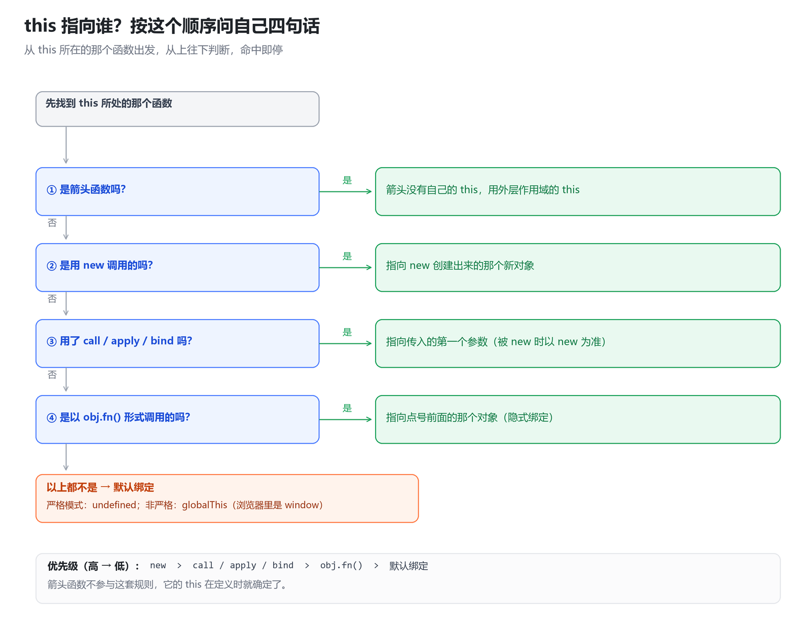

# 一篇讲透 JS 的 this（零基础版）

> 这篇只用到你已经学过的知识：函数、对象、`new`、事件监听。文中代码都可以直接运行，输出就是真实结果。
> 用到 `call` / `bind` / 箭头函数的部分集中放在最后，标了「进阶，可以先跳过」，不影响前面的理解。

## 先看两段代码

```js
const user = {
  name: '小明',
  greet() { return '你好，' + this.name }
}

console.log(user.greet())   // 你好，小明
```

```js
const f = user.greet   // 只是把函数赋值给另一个变量
console.log(f())       // 你好，undefined
```

同一个函数，一行代码都没改，只因为**调用方式**不同，`this.name` 就变成了 `undefined`。

这就是 `this` 最容易被误解的地方：**它不属于函数本身，而是在每次调用时临时决定的**。

---

## 一、`this` 到底是什么

`this` 是 JS 的一个**关键字**，不是变量——不能给它赋值，也不能当参数名。

它存在的意义很朴素：**让函数在运行时知道自己"被谁调用"，从而省掉一个显式参数**。

没有 `this` 时：

```js
function greet(person) {
  return '你好，' + person.name
}
greet(user)     // 每次都得把自己传进去
```

有了 `this`：

```js
function greet() {
  return '你好，' + this.name
}
user.greet()    // 不用传了，函数自己知道是 user 在调用
```

一句话：**`this` 是"这次调用发生时，函数周围的那个对象"**。

---

## 二、全局和普通函数里的 `this`

### 全局里的 `this`

在浏览器的 `<script>` 里直接写 `this`：

```js
console.log(this)   // window
```

顶层的 `this` 就是 `window`（浏览器窗口对象）。

> 换到 Node 里跑，顶层的 `this` 不是 `window`，而是一个空对象（`module.exports`）。这是环境差异，不是语法问题。浏览器里记住 `window` 就够了。

### 普通函数单独调用

```js
function foo() {
  console.log(this)
}
foo()   // window
```

`foo()` 前面没有任何对象，这叫"独立调用"。非严格模式下，`this` 会退回到全局对象 `window`。

> 如果代码开头写了 `'use strict'`（严格模式），独立调用时 `this` 会是 `undefined`。这个现在不用深究，知道有这回事就行。

---

## 三、对象方法里的 `this`（重点）

这是实际开发中最重要的场景：

```js
const user = {
  name: '小明',
  greet() {
    return '你好，' + this.name
  }
}

console.log(user.greet())   // 你好，小明
```

规则只有一条：**`this` 指向"点号前面"的那个对象**。

因为调用是 `user.greet()`，点号前面是 `user`，所以函数里的 `this` 就是 `user`，`this.name` 就是 `'小明'`。

多层也只看最后一层：

```js
const a = {
  name: 'a',
  b: {
    name: 'b',
    getName() { return this.name }
  }
}

console.log(a.b.getName())   // b
```

点号前面是 `a.b`，所以 `this` 是 `a.b`，不是 `a`。

---

## 四、`this` 为什么会"丢"

把方法从对象上"摘下来"，它就不知道原来属于谁了：

```js
const user = {
  name: '小明',
  getName() { return this.name }
}

console.log(user.getName())   // 小明

const f = user.getName
console.log(f())              // undefined
```

`const f = user.getName` 只是把**函数本身**取出来，`user` 这个"前缀"没了。调用 `f()` 时前面什么都没有，于是走"独立调用"的规则，`this` 变成 `window`，`window.name` 是空的，所以 `undefined`。

把它当参数传出去也是一样：

```js
function callIt(fn) {
  return fn()        // 这里只是 fn()，前面没有任何对象
}

console.log(callIt(user.getName))   // undefined
```

**修法：外面包一层普通函数，让"点号"重新出现。**

```js
function safe() {
  return user.getName()   // 这里是通过 user 调用的，this 就是 user
}

console.log(safe())   // 小明
```

也可以在传参时包一层：

```js
callIt(function () {
  return user.getName()
})                     // 小明
```

记住：**决定 `this` 的不是函数在哪定义，而是它被执行时前面有没有对象。**

---

## 五、`new` 的时候，`this` 是谁

学过构造函数的话，这条很直观：

```js
function Person(name) {
  this.name = name
}

const p = new Person('张三')
console.log(p.name)   // 张三
```

用 `new` 调用时，`this` 指向**新创建出来的那个对象**。

所以构造函数里的 `this.name = name`，本质是在给新对象挂属性。`new` 一共做了四件事：

1. 创建一个空对象 `{}`；
2. 让这个空对象的原型指向 `Person.prototype`；
3. 执行函数体，`this` 指向这个空对象；
4. 返回这个对象（构造函数没有返回别的对象时）。

---

## 六、事件回调里的 `this`

在 DOM 事件里，回调函数的 `this` 就是**监听事件的那个元素**：

```html
<button id="btn">点击我</button>

<script>
document.getElementById('btn').addEventListener('click', function () {
  this.innerText = '点击了'   // this === 按钮元素
  console.log(this)
})
</script>
```

这等价于 `document.getElementById('btn').innerText = '点击了'`，但少写了一遍查询，而且语义更清楚：**"我"就是被点的那个按钮**。

一个细节：`this` 指的是**绑定监听器的元素**，不一定是 `event.target`。事件冒泡时两者可能不是同一个，现在知道就好。

---

## 七、进阶（可以先跳过）

到这里，基础部分已经能解释大部分场景了。下面三条是面试常考、但可以先放着的内容。

### 7.1 箭头函数：没有自己的 `this`

箭头函数的写法是 `() => {}`，它**没有自己的 `this`**，用的是外层作用域的 `this`。

```js
const user = {
  name: '小明',
  say() {
    const inner = () => this.name   // 箭头：用 say 的 this
    return inner()
  }
}

console.log(user.say())   // 小明
```

而**在对象里直接写箭头**，`this` 并不指向这个对象：

```js
const bad = {
  name: 'bad',
  say: () => this === bad
}

console.log(bad.say())   // false
```

所以：**需要 `this` 指向对象或元素时，用普通函数；只是写个纯逻辑的小函数时，箭头更短。**

### 7.2 `call` / `apply` / `bind`：手动指定 `this`

```js
function who() { return this.name }

console.log(who.call({ name: 'call' }))     // call
console.log(who.apply({ name: 'apply' }))   // apply
console.log(who.bind({ name: 'bind' })())   // bind
```

- `call` / `apply`：立即执行，区别只在参数写法（`call` 逐个传，`apply` 传数组）；
- `bind`：不执行，返回一个"`this` 已经固定"的新函数。

用 `bind` 也能修上面那个 `this` 丢失的问题：

```js
const safe = user.getName.bind(user)
console.log(safe())   // 小明
```

### 7.3 一张判断图



从 `this` 所在的那个函数出发，按顺序问：

1. 是箭头函数吗？→ 用外层作用域的 `this`
2. 是 `new` 调用的吗？→ 新对象
3. 用了 `call` / `apply` / `bind` 吗？→ 传入的对象
4. 是 `obj.fn()` 调用的吗？→ 点号前面的对象
5. 都不是 → 严格模式 `undefined`，否则 `window`

优先级：**new > call/apply/bind > obj.fn() > 默认**。

---

## 八、自测题

**1. 浏览器顶层直接写 `this`，是什么？**
> `window`。

**2. 普通函数直接调用，`this` 是什么？**
> 非严格模式下是 `window`；严格模式是 `undefined`。

**3. `user.getName()` 里的 `this` 是谁？**
> `user`，看"点号前面"。

**4. `a.b.getName()` 呢？**
> `a.b`，只看最后一层。

**5. `const f = user.getName; f()` 里的 `this` 是谁？**
> `window`（非严格）。函数被"摘下来"了，和 `user` 没关系了。

**6. 怎么修上面那个 `this` 丢失？**
> 用 `user.getName.bind(user)`，或者包一层 `function () { return user.getName() }`。

**7. `new Person()` 里的 `this` 是谁？**
> `new` 创建出来的那个新对象。

**8. 事件监听的回调里，`this` 是谁？**
> 绑定监听器的那个 DOM 元素。

---

## 九、三条总结

1. **`this` 由调用方式决定，不由定义位置决定**：`obj.fn()` 看对象，`fn()` 看默认值，`new` 看新实例。
2. **方法是"绑"在调用上的**：把方法摘下来赋值给别人，`this` 就丢了；包一层或 `bind` 可以救回来。
3. **优先级**：`new` > `call/apply/bind` > `obj.fn()` > 默认。

判断顺序就按那张图走，四句话问完，`this` 一定不会错。
