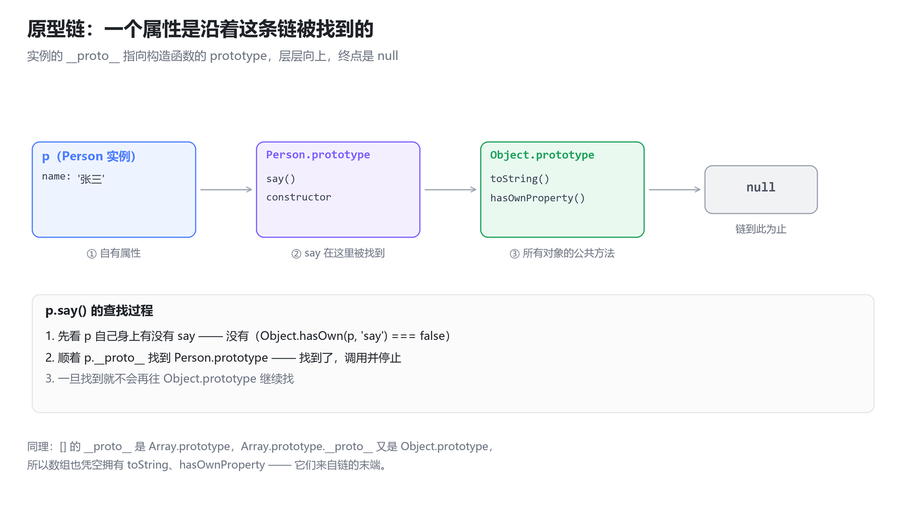
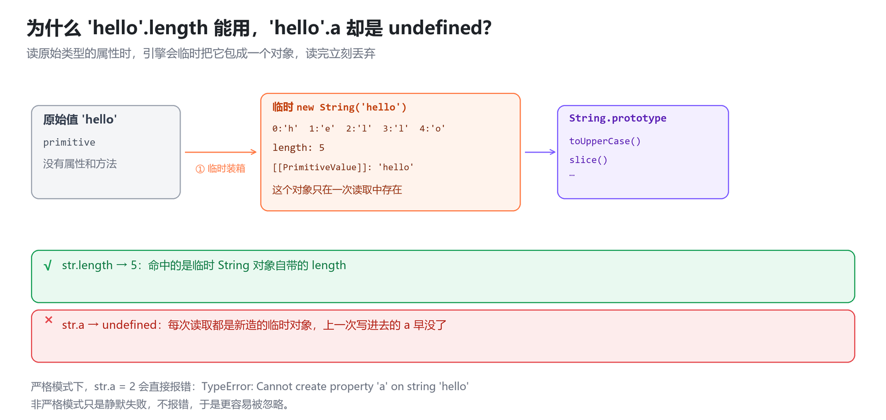

# 一篇讲透 JS 对象：数据类型、原型链与包装类

学 JS 到一定阶段，几乎都会撞上同一堵墙：对象相关的知识看起来都懂——字面量会写、属性会取、`new` 会用——可题目只要稍微拐个弯，心里就开始发虚。

比如 `'hello'.length` 明明是 5，给 `'hello'` 加个属性却不生效；两个长得一模一样的对象，用 `===` 一比居然是 `false`；`new` 出来的实例，凭什么能调用构造函数里压根没写的方法。

这些并不是零散的知识点，而是同一套规则在不同角度的投影：**值怎么存、属性怎么找、原始类型怎么"假装"成对象**。

这篇文章就按这条线走：先把基本类型和引用类型彻底分开，再拆开 `new` 的四步，然后画出原型链（配了图），最后回到 `'hello'.a` 这个看起来最没道理的现象——那时你会发现，它只是"装箱、读取、丢弃"的必然结果。

文中代码都能直接运行，输出就是真实结果。读完的标准很简单：给你一段涉及对象的代码，你能在运行之前说出它为什么是这个结果。

## 三个看似矛盾的现象

```js
console.log('hello'.length)   // 5
'hello'.a = 2                 // 不报错
console.log('hello'.a)        // undefined
```

能读出 `length`，说明字符串"像"对象；既然像对象，为什么给它加属性却加不上？

再看两个更常见的：

```js
const a = { n: 1 }
const b = a
b.n = 2
console.log(a.n)        // 2  —— 明明改的是 b

console.log({ n: 1 } === { n: 1 })   // false —— 长得一样却不相等
```

这三个问题，指向同一套底层规则：**JS 里"对象"是什么、值怎么存、属性怎么找**。把这三件事讲清楚，对象这块就没有黑箱了。

---

## 一、先分清：基本类型和引用类型

JS 的数据类型分两类。

**基本类型（7 种）**

| 类型 | 例子 |
| --- | --- |
| number | `1`、`3.14`、`NaN` |
| string | `'hello'` |
| boolean | `true` / `false` |
| null | `null` |
| undefined | `undefined` |
| symbol | `Symbol('a')` |
| bigint | `10n` |

**引用类型**

`object` 是唯一一种引用类型。但平时说的数组、函数、日期、正则、错误，本质上都是对象：

```js
console.log(typeof 1)              // number
console.log(typeof 'a')            // string
console.log(typeof null)           // object   ← 历史遗留的 bug
console.log(typeof [])             // object
console.log(typeof function () {}) // function ← 但函数也是对象，只是 typeof 特判了
```

顺带说一个面试常问的点：`typeof null` 返回 `"object"`，这是 JS 第一版实现里的 bug，为了兼容一直没改。判断 `null` 要用 `x === null`。

再看 `symbol`。它最常见的用途是造"永远不相等"的标识：

```js
console.log(Symbol('a') === Symbol('a'))  // false
console.log('hello' === 'hello')          // true
```

即使描述一样，两次 `Symbol()` 也是两个不同的值。这也是为什么它适合做对象里的"隐藏键"。

---

## 二、"万物皆对象"这句话对不对

只说对一半。

- **引用类型**（对象、数组、函数……）确实是对象；
- **基本类型**（数字、字符串、布尔……）**不是对象**，它们没有属性，也不能加属性。

但你在写 `'hello'.length` 的时候，代码又确实跑通了。这不是矛盾，而是引擎在背后做了一次**临时转换**——这就是第七节的"包装类"。先记住结论：**基本类型不是对象，只是能"借"对象的方法。**

---

## 三、值 vs 引用：最容易踩的坑

```js
const a = { n: 1 }
const b = a
b.n = 2
console.log(a.n)   // 2
```

`const b = a` 并没有复制出一个新对象，只是把**同一个对象的地址**复制给了 `b`。所以改 `b.n` 就是改 `a.n`。

对比基本类型：

```js
let a = 1
let b = a
b = 2
console.log(a)     // 1
```

基本类型复制的是**值本身**，改 `b` 不影响 `a`。

还有一个新手经常困惑的现象：

```js
console.log({ n: 1 } === { n: 1 })   // false
```

`===` 对对象比较的是**引用（地址）**，不是内容。两个字面量分别创建了两个不同的对象，地址不同，所以不相等。要比较内容，得逐键比较（或者用 `JSON.stringify`，但它有坑，后面讲）。

---

## 四、创建对象与增删改查

最常用的是字面量：

```js
let obj = {
  name: '张三',
  age: 18,
  sex: '男'
}                         // 创建字面量对象

obj.girlfriend = '李四'    // 增
obj.age = 20              // 改
delete obj.sex            // 删

let k = 'hello'
obj[k] = 'world'          // 方括号：键来自变量时用

console.log(obj)
```

输出：

```
{ name: '张三', age: 20, girlfriend: '李四', hello: 'world' }
```

三个细节：

1. **`delete` 删的是属性**，不是变量。删完 `'sex' in obj` 就是 `false`；
2. **点号和方括号的区别**：点号后面只能跟合法标识符，方括号里可以放变量、可以放任意字符串（比如 `obj['my-key']`）；
3. 新增的属性会排在已有属性后面。

还有一条容易被忽略的规则：**对象的键顺序**。整数键会被自动按升序排在最前面，字符串键保持插入顺序：

```js
console.log(Object.keys({ b: 1, 2: 2, a: 3, 1: 4 }))
// [ '1', '2', 'b', 'a' ]
```

`new Object()` 创建出来的结果和字面量完全一样，只是写法不同：

```js
let obj = new Object()
obj.name = '张三'
console.log(obj)   // { name: '张三' }
```

---

## 五、`new` 背后做了什么

实际开发里更常见的是用**构造函数**批量造对象：

```js
function Person(name, age) {
  this.name = name
  this.age = age
}

const p = new Person('张三', 18)
console.log(p.name)   // 张三
```

`new Person('张三', 18)` 这行代码，引擎做了四件事：

1. 创建一个空对象 `{}`；
2. 把这个空对象的 `__proto__` 指向 `Person.prototype`；
3. 执行 `Person` 的函数体，函数里的 `this` 指向这个新对象；
4. 如果构造函数没有返回别的对象，就把这个新对象返回。

所以 `this.name = name` 实际上是在给新对象挂属性。**这就是"实例对象"的由来。**

第 2 步是关键，它把实例和原型连在了一起，下面接着说。

---

## 六、原型与原型链

先看两个概念：

- **`prototype`（显式原型）**：每个**函数**天生就有的属性，值是一个对象；
- **`__proto__`（隐式原型）**：每个**对象**天生就有的属性，指向创建它的构造函数的 `prototype`。

它们的关系只有一条，但极其重要：

> **实例的 `__proto__` === 构造函数的 `prototype`**

验证一下：

```js
function Person(name) {
  this.name = name
}
Person.prototype.say = function () {
  return 'hi, ' + this.name
}

const p = new Person('张三')

console.log(p.__proto__ === Person.prototype)                   // true
console.log(Person.prototype.__proto__ === Object.prototype)     // true
console.log(Object.prototype.__proto__)                         // null
console.log(p.say())                                            // hi, 张三

console.log(Object.hasOwn(p, 'name'))   // true  —— 实例自己的
console.log(Object.hasOwn(p, 'say'))    // false —— say 在原型上
```

一个属性是怎么被找到的？

1. 先看对象自己有没有；
2. 没有就顺着 `__proto__` 往上找；
3. 一直找到 `Object.prototype`，再往上就是 `null`，还没找到就返回 `undefined`。



这就是**原型链**。它带来两个结果：

**好处：所有实例共享方法，省内存。** `say` 只存一份，挂在 `Person.prototype` 上，所有实例都能用。

**坑：共享的东西也会被共享。** 如果在原型上放引用类型：

```js
function A() {}
A.prototype.list = []

const x = new A()
const y = new A()
x.list.push(1)

console.log(y.list)   // [ 1 ] —— y 被"波及"了
console.log(x.list === y.list)   // true
```

这就是为什么规范建议：**数据放在实例上（构造函数里 `this.xxx = ...`），方法才放原型上。**

几个相关工具：

```js
console.log(p instanceof Person)                       // true —— 沿原型链判断
console.log(Object.getPrototypeOf(p) === Person.prototype)  // true，比 __proto__ 更规范
```

`__proto__` 其实是 `Object.prototype` 上的一个访问器属性（历史遗留），现代代码推荐 `Object.getPrototypeOf()` / `Object.setPrototypeOf()`。

最后补充一个极端情况——**没有原型的对象**：

```js
const bare = Object.create(null)
bare.x = 1
console.log(bare.x)              // 1
console.log(typeof bare.toString) // undefined —— 连 toString 都没有
```

这种对象常用作纯粹的"字典"，因为它不会继承任何东西，也就不会和 `toString`、`constructor` 这些键名冲突。

---

## 七、包装类：回到开头那个问题

现在可以解释 `'hello'.length` 了。

```js
var str = 'hello'
str.a = 2

console.log(str)          // hello
console.log(str.a)        // undefined
console.log(str.length)   // 5
console.log(typeof str)   // string
```

引擎在读取 `str.length` 时，做了三步：

1. **装箱**：临时用 `new String('hello')` 造一个对象；
2. **读取**：在临时对象上找 `length`，找到 5；
3. **丢弃**：读完立刻把这个临时对象销毁，`str` 仍然是原始类型。



所以 `str.a = 2` 的真相是：`a` 被写到了**那个临时对象**上，而这个对象马上就被销毁了。下一次读 `str.a` 时，引擎又造了一个新的临时对象，上面当然没有 `a`，于是返回 `undefined`。

两个必须纠正的常见误解：

**误解一：`length` 在 `String.prototype` 上。**
不是。`length` 是临时 String 对象**自己的**属性，由字符串内容决定。真正在 `String.prototype` 上的是 `toUpperCase`、`slice`、`indexOf` 这些方法。

**误解二：给原始类型加属性只是"静默失败"，所以无害。**
非严格模式下确实不报错。但严格模式会直接抛异常：

```js
'use strict'
const s = 'hello'
s.a = 2
// TypeError: Cannot create property 'a' on string 'hello'
```

数字同理：

```js
const n = 123
n.a = 2
console.log(n)   // 123 —— 还是那个原始值
```

最后区分一下包装对象和原始值，这是面试高频题：

```js
const boxed = new String('hello')

console.log(typeof boxed)        // object
console.log(boxed == 'hello')    // true  —— 比较时会把对象拆箱成原始值
console.log(boxed === 'hello')   // false —— 一边是对象，一边是字符串
console.log(boxed.length)        // 5
```

`new String()` 造出来的是**真对象**，能加属性、能长期存在，但日常开发几乎用不到——除了 `new Boolean`、`new Number` 这些"造对象"的写法是明确的坏习惯。

---

## 八、常用 API 与拷贝

Object 上一批静态方法，基本是日常必用：

```js
const o = { b: 2, a: 1 }

console.log(Object.keys(o))     // [ 'b', 'a' ]
console.log(Object.values(o))   // [ 2, 1 ]
console.log(Object.entries(o))  // [ [ 'b', 2 ], [ 'a', 1 ] ]

const frozen = Object.freeze({ x: 1 })
frozen.x = 2
console.log(frozen.x)           // 1 —— 冻结后改不动（严格模式会抛错）
```

| 方法 | 作用 |
| --- | --- |
| `Object.keys / values / entries` | 拿键、值、键值对数组 |
| `Object.assign(target, ...sources)` | 合并/浅拷贝 |
| `Object.freeze` / `Object.isFrozen` | 冻结对象，禁止增删改 |
| `Object.create(proto)` | 指定原型创建对象 |
| `Object.defineProperty` | 精细控制属性（可枚举、可写、getter/setter） |
| `Object.hasOwn(obj, key)` | 是否是自身属性（比 `hasOwnProperty` 更安全） |

### 浅拷贝与深拷贝

这是引用类型最容易出事故的地方：

```js
const src = { user: { name: '张三' } }

const shallow = Object.assign({}, src)   // 等价于 { ...src }
shallow.user.name = '李四'
console.log(src.user.name)               // 李四 —— 原对象被改了！
```

因为浅拷贝只复制第一层，`user` 这个**引用**被复制了，两个对象指向同一个内层对象。

深拷贝：

```js
const deep = structuredClone(src)
deep.user.name = '王五'
console.log(src.user.name)               // 李四 —— 没被影响
```

`structuredClone` 是现在浏览器和 Node 都支持的深拷贝方案。老代码里常见的 `JSON.parse(JSON.stringify(obj))` 也能用，但它会丢掉函数、`undefined`、`Symbol`，还会把 `Date` 变成字符串、把 `RegExp` 变成空对象，慎用。

---

## 九、class 只是原型的语法糖

ES6 的 `class` 看起来像新东西，其实底层还是原型：

```js
class Animal {
  constructor(name) { this.name = name }
  speak() { return this.name + ' 叫了一声' }
}

class Dog extends Animal {
  speak() { return super.speak() + '：汪' }
}

const d = new Dog('旺财')
console.log(d.speak())                 // 旺财 叫了一声：汪
console.log(d instanceof Dog)          // true
console.log(d instanceof Animal)       // true
console.log(Object.hasOwn(d, 'speak')) // false —— 方法挂在 Dog.prototype 上
```

`super.speak()` 实际就是去 `Animal.prototype` 上找方法。所以理解了原型链，`class`、`extends`、`super` 都不用单独背。

---

## 十、8 道自测题

**1. `typeof null` 是什么？**
> `'object'`。这是历史 bug，判断 null 要用 `x === null`。

**2. `const b = a`（a 是对象）之后改 `b.n`，`a.n` 会变吗？**
> 会。复制的是引用，两个变量指向同一个对象。

**3. `{ n: 1 } === { n: 1 }` 为什么是 false？**
> 对象比较的是引用地址，两个字面量是两个不同的对象。

**4. `p.__proto__ === Person.prototype` 成立吗？**
> 成立。`new` 的第二步就是把实例的隐式原型指向构造函数的显式原型。

**5. 下面输出什么？**

```js
function A() {}
A.prototype.list = []
const x = new A(), y = new A()
x.list.push(1)
console.log(y.list)
```
> `[ 1 ]`。原型上的引用类型被所有实例共享。数据应该放在构造函数里。

**6. `'hello'.a = 2` 之后 `'hello'.a` 是什么？为什么？**
> `undefined`。属性写到了临时的包装对象上，读完就销毁了。

**7. `new String('hello')` 和 `'hello'` 相等吗？**
> `==` 相等（会拆箱），`===` 不相等（类型不同）。`typeof new String('x')` 是 `'object'`。

**8. `const` 声明的对象能改属性吗？**
> 能。`const` 锁的是"变量绑定"，不是对象内容。

```js
const c = { n: 1 }
c.n = 2      // 可以
c = {}       // TypeError: Assignment to constant variable.
```

---

## 十一、速查表

| 问题 | 结论 |
| --- | --- |
| 哪些是对象？ | 只有引用类型是对象；基本类型不是，但能临时装箱"借"方法 |
| 对象怎么比较？ | `===` 比地址，不比内容 |
| 属性怎么查找？ | 自身 → `__proto__` → … → `Object.prototype` → `null` |
| `prototype` 和 `__proto__`？ | 函数有 `prototype`，对象有 `__proto__`，实例的 `__proto__` 指向构造函数的 `prototype` |
| 方法放哪？ | 方法放原型（共享），数据放实例（各一份） |
| 原始类型能加属性吗？ | 不能。写在临时对象上，读完即销毁 |
| 拷贝要注意什么？ | 浅拷贝只复制第一层引用，深层修改会影响原对象 |

---

## 最后三句话

1. **对象是引用类型**，赋值和比较传的都是地址，不是内容。
2. **属性查找沿原型链进行**：自身 → `__proto__` → … → `null`；共享方法放原型，独立数据放实例。
3. **原始类型不是对象**，`'hello'.length` 是引擎临时装箱的结果，装箱对象用完就丢，所以给它加属性一定是 `undefined`。

把这三句吃透，对象相关的问题基本就只剩 API 记忆了。
