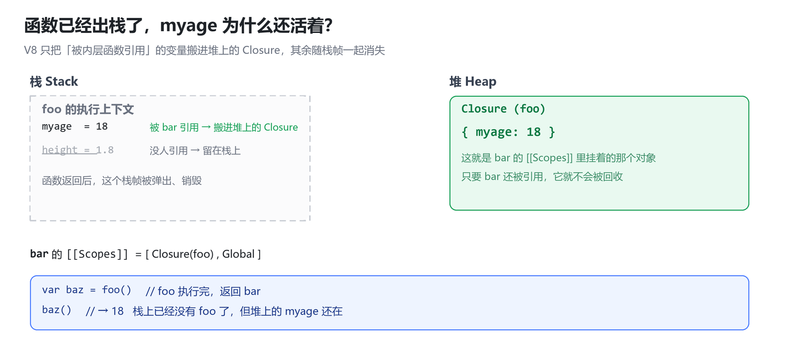

# 一篇讲透 JS 闭包：作用域链、内存结构，和那个经典的 for 循环陷阱

> 本文所有代码都实测过，输出即真实结果。文中两张图是示意图，建议对照代码一起看。

## 先看一段代码

```js
function foo() {
  var myname = '小明'
  return {
    getName: function () { return myname },
    setName: function (name) { myname = name }
  }
}
var bar = foo()            // foo 已经执行完了
bar.setName('小红')
console.log(bar.getName()) // ？
```

`foo` 早就返回了。按"函数一返回、局部变量就销毁"的直觉，这里应该拿不到 `myname`。

但实际输出是：

```
小红
```

不但读到了，还能**改**。而且 `bar.myname` 是 `undefined`——外部根本碰不到这个变量。

这就是闭包。本文从作用域链讲起，一路讲到内存结构，最后用一段 `for` 循环收尾：那段代码 90% 的人第一次都会答错。

---

## 一、地基：作用域链

JS 引擎执行函数时会创建一个**执行上下文**。找变量时，先在当前上下文里找；找不到就顺着**父级作用域**往上找，直到全局作用域；全局也没有，才抛 `ReferenceError`。这条从内到外的查找路径就是**作用域链**。

关键点在于：**这条链由函数"定义的位置"决定，而不是"调用的位置"。**

```js
function bar() {
  console.log(myname)
}
function foo() {
  var name = 'foo'
  bar()
}
var myname = 'global'
foo()
```

输出：

```
global
```

`bar` 是在 `foo` 里被调用的，但它读到的不是 `foo` 的变量，而是全局的 `global`。因为 `bar` 定义在全局，它的作用域链只有 `bar 自己 → 全局`，`foo` 的内部压根不在链上。

> 这就是"词法作用域"（也叫静态作用域）：**函数在哪定义，就永远在哪找变量**。JS 没有动态作用域。

---

## 二、闭包到底是什么

一句话版本：

> **闭包 = 函数 + 它定义时所在的那个作用域。**

当函数 A 里定义了函数 B，B 又引用了 A 的变量，最后 B 被带到 A 的外部去执行——A 的执行上下文虽然退出了，但**被 B 引用的那些变量会活下来**，形成一个封闭的环境，这个环境就是闭包。

拆成三个条件，缺一不可：

1. 有一个内层函数；
2. 内层函数引用了外层函数的变量；
3. 内层函数在外层函数之外被调用（被返回、被存起来、被当回调传出去）。

三者同时满足，闭包才有意义。注意第 3 条：如果 B 只在 A 内部调用，A 的栈帧还在栈上，变量本来就能访问，谈不上"保留"。

### 一个容易记错的细节

很多资料会写"被引用的变量以集合的方式保留在**调用栈**中"。

更准确的说法是：**栈上的执行上下文照常销毁，被引用的变量被搬到堆上**，挂在函数对象的 `[[Scopes]]` 里。栈是"用完即弹"的，不可能为了一个闭包一直占着。

下面的图能说明这件事。

---

## 三、闭包住在哪里

```js
function foo() {
  var myage = 18
  let height = 1.8

  function bar() {
    console.log(myage)
  }
  return bar
}
var baz = foo()
```

这段代码没有任何输出——因为 `baz` 还没被调用。但 `foo` 返回之后，`bar` 已经"记住"了 `myage`。



图里有两个信息值得单独说：

**第一，栈帧确实销毁了。** `foo` 执行完，它的执行上下文就被弹出栈了，`height` 这种没人引用的变量跟着一起消失。

**第二，引擎只搬"被引用"的变量。** V8 不是把 `foo` 的所有局部变量都塞进闭包，而是做了一次作用域分析：`bar` 里读了 `myage`，所以 `myage` 进堆上的 Context；`height` 没人读，留在栈上，随栈帧销毁。

> 这也解释了一个性能优化点：闭包里保留的变量越少，内存占用越小。引擎已经帮你做了裁剪，但你仍然要避免在闭包里引用巨大的对象。

调用 `baz()` 自然输出 `18`：`baz` 就是 `bar`，它执行时沿作用域链找到堆上的 `myage`。

---

## 四、作用域链的查找顺序

看一段稍微绕一点的代码：

```js
function bar() {
  var myname = 'bar 内部的 myname'
  let test1 = 100
  if (1) {
    let myname = '块里的 myname'
    console.log(test1)   // ？
  }
}

function foo() {
  let test = 2
  {
    let test = 3
    bar()
  }
}

var myname = 'global'
let test = 1
foo()
```

输出：

```
100
```

为什么是 `100`，而不是 `3`、`2` 或 `1`？

因为 `bar` 定义在**全局**，它的作用域链只有两节：`bar 自己的函数作用域 → 全局作用域`。`foo` 内部的 `test = 2`、块里的 `test = 3`，全都不在 `bar` 的链上——哪怕 `bar` 就是在那个块里被调用的。

而 `bar` 自己的函数作用域里有 `let test1 = 100`，所以直接命中。

一句话总结这一节：**谁调用你不重要，你在哪定义才重要。**

---

## 五、闭包的真实用途

### 5.1 私有状态 + 存取器

```js
function foo() {
  var myname = '小明'
  let test1 = 1
  const test2 = 2
  var innerBar = {
    getName: function () {
      console.log(test1)
      return myname
    },
    setName: function (name) {
      myname = name
    }
  }
  return innerBar
}
var bar = foo()
bar.setName('小红')
bar.getName()
console.log(bar.getName())
```

输出：

```
1
1
小红
```

逐行看：

- `bar.setName('小红')` 改的是**闭包里的** `myname`，不是 `bar` 自己的属性；
- 第一次 `bar.getName()` 打印 `test1`（1），返回 `'小红'` 但没打印；
- 第二次 `bar.getName()` 又打印一次 1，然后外层 `console.log` 把返回值打出来。

这段代码的价值不在输出，而在于它展示了一个**带私有状态的对象**：

- `myname` 只能通过 `setName` 改，外部拿不到 `bar.myname`；
- 两个方法共享同一份 `myname`，`setName` 改完 `getName` 立刻能看到。

这就是**模块模式**的雏形，也是各种"计数器""防抖节流""缓存"实现的底层原理。

### 5.2 反例：这不是封装

```js
let i = 0
function add() {
  i++
  console.log(i)
}
add(); add(); add()
```

输出 `1 2 3`。看起来像个计数器，但它**不是闭包封装**——`i` 躺在全局，任何代码都能改它。对比 5.1 里的 `myname`，差别一眼就看出来了。

### 5.3 正确的计数器

```js
function createCounter() {
  let count = 0
  return {
    inc() { return ++count },
    get() { return count }
  }
}
const c = createCounter()
c.inc(); c.inc()
console.log(c.get())          // 2
console.log(typeof count)     // undefined —— 外部根本拿不到
```

每次调用 `createCounter()` 都会生成一份独立的 `count`，多个计数器互不干扰。这就是闭包最重要的能力：**为每份数据创建独立的私有空间**。

---

## 六、闭包的两个评价

| | 说明 |
| --- | --- |
| **优点** | 封装私有变量，隐藏内部状态；让状态在函数调用之间保持（计数器、单例、缓存）；是实现模块化、柯里化、防抖节流的基础 |
| **缺点** | 被闭包引用的变量不会被回收，长期持有大对象会造成内存占用（常说的"内存泄漏"） |

关于"内存泄漏"，要说得准确一点：

- 闭包**不是**必然泄漏。变量没人用、函数对象也没人引用时，GC 照样回收；
- 真正的问题场景是：闭包引用了大对象（DOM 节点、大数组、定时器），而闭包本身被长期持有（挂在全局、挂在事件监听上没解绑）；
- 常见解法：不再使用时把引用置 `null`、及时 `clearInterval`、`removeEventListener`、避免在闭包里引用整个大对象而只取需要的字段。

```js
function outer() {
  const big = new Array(1000000).fill(0)
  return function () { return big.length }
}
let fn = outer()      // big 被闭包留住
fn = null             // 切断引用，big 可以被回收
```

---

## 七、经典陷阱：为什么打印了 5 个 6

现在揭晓开头卖的那个关子。

```js
var arr = []
for (var i = 1; i <= 5; i++) {
  arr.push(function () {
    console.log(i)
  })
}
// 执行
for (var j = 0; j < arr.length; j++) {
  arr[j]()
}
```

先别往下看，猜一下输出。

大多数人会说 `1 2 3 4 5`，实际是：

```
6
6
6
6
6
```

### 引擎眼里发生了什么

 时的 V8 调用栈](closure-callstack.png)

图里分两半看：

**左边是调用栈。** 执行 `arr[0]()` 时，栈上有三层：

1. 底层是**全局执行上下文**，`var arr` 和 `var i` 都挂在这里；
2. 中层是**匿名函数 #0 的执行上下文**，它自己内部没有任何变量声明；
3. 顶层是 `console.log`，一个内置函数，直接输出。

**右边是闭包关系。** `arr` 里的 5 个函数对象，每个都有 `[[Scopes]]`，但它们指向的是**同一个**全局环境——因为 `var i` 是全局变量，5 个函数是在同一份环境里创建出来的。

于是调用任意一个闭包时，执行 `console.log(i)` 的流程是：

1. 在自己的函数作用域里找 `i` —— 没有（函数体里没声明过 `i`）；
2. 沿作用域链找到全局环境 —— 找到了；
3. 此刻全局的 `i` 是多少？`for` 循环已经跑完，`i === 6`；
4. 输出 6。

五个函数，同一个 `i`，同一个 6。

### 真正的原因

`for` 循环本身不产生作用域（`var` 不认块级作用域）。整段代码里 `i` **只有一份**，5 个闭包共享它。等到它们真正执行时，循环早结束了，`i` 已经停在 6。

记住这句话，比背十遍定义都管用：

> **闭包保存的是变量的"引用"，不是"取值那一刻的副本"。**

---

## 八、三种修复方式

### 方案 1：`let`（推荐）

```js
var arr = []
for (let i = 1; i <= 5; i++) {
  arr.push(function () {
    console.log(i)
  })
}
for (var j = 0; j < arr.length; j++) arr[j]()
```

输出：

```
1
2
3
4
5
```

`let` 在 `for` 循环里是**每次迭代创建一个新的词法环境**（规范里叫 `CreatePerIterationEnvironment`）。5 次循环 = 5 份 `i` = 5 个闭包各自持有一份，互不影响。

### 方案 2：IIFE 立即执行函数

```js
var arr = []
for (var i = 1; i <= 5; i++) {
  (function (k) {
    arr.push(function () {
      console.log(k)
    })
  })(i)
}
for (var j = 0; j < arr.length; j++) arr[j]()
```

输出同样是 `1 2 3 4 5`。

原理是：调用 IIFE 时把当前的 `i` 作为实参传进去，`k` 是这次调用的**局部变量**，每调用一次就有一份新的 `k`。这是 ES6 之前的标准写法。

### 方案 3：用 `forEach` 之类自带参数的方法

```js
var arr = []
;[1, 2, 3, 4, 5].forEach(function (i) {
  arr.push(function () {
    console.log(i)
  })
})
arr.forEach(function (f) { f() })
```

输出 `1 2 3 4 5`。回调函数的形参天然是每次调用独立的局部变量，等价于 IIFE 的效果。

### 对比

| 方案 | 原理 | 评价 |
| --- | --- | --- |
| `let` | 每轮迭代新建词法环境 | 最简洁，现代代码首选 |
| IIFE | 形参复制当前值 | ES6 之前的标准解法，理解闭包必学 |
| `forEach` | 回调形参天然独立 | 语义更清晰，但要注意 `this` 和 `break` 限制 |

---

## 九、面试怎么答

被问到"什么是闭包"，30 秒版：

> 闭包是函数和它定义时所在作用域的组合。当内层函数引用了外层函数的变量，并且在外层函数之外被执行时，这些变量不会被销毁，而是保存在堆上的闭包环境里。所以闭包可以记住并修改外层函数的状态，实现私有变量、状态保持和模块化。代价是被引用的变量会一直驻留内存，滥用可能造成内存占用。

常见追问：

| 追问 | 答题要点 |
| --- | --- |
| 闭包会导致内存泄漏吗？ | 不会必然泄漏。只有闭包长期存活且引用大对象时才成问题；正确做法是置 `null`、解绑事件、清定时器 |
| 闭包存在栈上还是堆上？ | 栈帧照常销毁，被引用的变量放到堆上的 Context，通过 `[[Scopes]]` 访问 |
| `var` 和 `let` 的闭包差异？ | `var` 只有一份（函数/全局作用域），`let` 每次迭代新建环境，所以 `for + let` 不会出现 5 个 6 |
| 举例说明闭包的实际应用 | 防抖节流、计数器、单例、柯里化、模块模式、React Hooks 的状态保存 |

---

## 十、三句话总结

1. **作用域链看"定义位置"，不看"调用位置"**——这是理解闭包的前提。
2. **闭包 = 函数 + 它定义时的作用域**；栈帧会销毁，被引用的变量搬到堆上，所以状态能活下来。
3. **闭包保存的是引用而不是副本**——`for + var` 打印 5 个 6，就是这句话最直观的代价。

如果只能记住一件事：**判断闭包读到什么值，不要看它在哪一行创建，要看它执行时那个变量是什么。**
